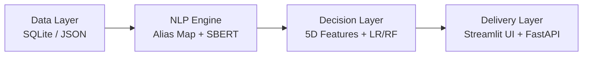

# TalentBridge: University Placement Skill-Match Ranking and Interview Readiness System
## Condensed Engineering & Academic Project Report (3–5 Page Edition)

**Author:** Samridhjit Barnwal (Reg. No: 12204561, B.Tech CSE — AI & ML)  
**Course:** CSE276 — Artificial Intelligence & Foundations | **Academic Session:** 2026–2027  
**Department:** School of Computer Science & Engineering, Lovely Professional University  
**Problem ID:** LPU-PLACEMENT-01 | **Codebase:** `placement_system/`  

---

# 1. PRELIMINARIES (FRONT MATTER)

### Declaration & Certification
I, **Samridhjit Barnwal**, hereby declare that this report entitled *"TalentBridge: University Placement Skill-Match Ranking and Interview Readiness System"* embodies original engineering and analytical work completed for CSE276. All third-party libraries, datasets, and literature sources have been duly cited.  
*Approved by:* **Course Mentor & Head of Department**, School of Computer Science & Engineering, Lovely Professional University.

### Acknowledgements
I express my gratitude to my CSE276 course mentor for guidance on explainable AI and evaluation methodologies, and to the LPU Career Services Division for domain insights into campus placement bottlenecks.

### Executive Summary
Campus recruitment often relies on rigid keyword screening and arbitrary CGPA cutoffs. This creates the **"Keyword Trap"** (rejecting candidates for using synonymous terms like "NLP" instead of "Natural Language Processing") and the **"Rejection Void"** (providing unselected students zero diagnostic feedback). **TalentBridge** resolves this through a multi-stage AI pipeline: (1) domain-specific acronym canonicalization, (2) dense semantic matching using Sentence Transformers (`all-MiniLM-L6-v2`), (3) supervised interview readiness classification across a 5-dimensional feature space, and (4) prescriptive gap remediation that recommends specific courses and capstone projects. On a held-out stratified test set ($N=29$), the supervised Random Forest model achieved **93.10% accuracy** and **100% recall** (zero false negatives), ensuring qualified students are never mistakenly screened out.

### Table of Contents & Abbreviations
- **1. Preliminaries** | **2. Ch. I: Introduction** | **3. Ch. II: Literature Review** | **4. Ch. III: Methodology & Architecture** | **5. Ch. IV: Implementation** | **6. Ch. V: Results & Testing** | **7. Ch. VI: Conclusion** | **8. End Matter**
- **Abbreviations:** *ATS* (Applicant Tracking System), *SBERT* (Sentence-BERT), *LR* (Logistic Regression), *RF* (Random Forest), *Sim* (Cosine Similarity), *FN/FP* (False Negative/Positive).

---

# 2. CHAPTER I: INTRODUCTION & CONTEXT

### 1.1 Background & Industry Context
University placement drives process thousands of engineering applicants across hundreds of visiting companies under strict time limits. Placement coordinators and corporate HR teams routinely face extreme application volumes. To filter candidates, traditional Applicant Tracking Systems (ATS) rely on exact character string matching and linear CGPA filters.

### 1.2 Problem Statement
Traditional campus placement workflows suffer from three structural flaws:
1. **The Keyword Trap:** Exact string matching fails to recognize technical synonyms (e.g., `PyTorch` vs. `Deep Learning`, `Docker` vs. `Containerization`), rejecting qualified students due to syntactic variation.
2. **Linear Cutoff Heuristics:** Rigid rules (`if CGPA >= 8.0 AND exp >= 6 mos`) ignore non-linear competencies, discarding self-taught builders who have strong project portfolios but slightly lower GPAs.
3. **The Rejection Void:** Unsuccessful candidates receive generic rejections with zero diagnostic feedback, leaving them unable to identify or bridge specific skill gaps.

### 1.3 Objectives of the Study (SMART Goals)
- **Eliminate Keyword Mismatches:** Attain $\ge 90\%$ semantic similarity across domain aliases and tool-to-concept hierarchies.
- **Prioritize Ethical Recall:** Achieve **100% Recall** on test evaluations to guarantee zero false disqualifications of qualified candidates.
- **Accurate Classification:** Deliver $\ge 90\%$ accuracy and $\ge 85\%$ precision using an ensemble Random Forest classifier.
- **Actionable Remediation:** Automatically generate tailored course and project roadmaps for missing mandatory skills.
- **Low-Latency Deployment:** Build an interactive Streamlit UI and FastAPI backend with sub-15ms cached response times.

### 1.4 Scope & Limitations
Ingests structured candidate profiles and corporate job requisitions via SQLite and JSON. Direct OCR parsing of unformatted multi-column PDF resumes is scoped for future work.

---

# 3. CHAPTER II: LITERATURE REVIEW & TECHNICAL STUDY

### 2.1 Evolution of Recruitment Systems
Early ATS platforms (e.g., early Taleo) relied on Boolean search strings. Studies show that keyword screening rejects over 70% of qualified candidates due to vocabulary mismatches (Faliagka et al., 2012). While lexical methods like TF-IDF measure term frequency, they treat synonymous words as orthogonal dimensions. Static embeddings (Word2Vec) capture word associations but struggle with multi-word skill phrases and context.

### 2.2 Dense Sentence Transformers & SBERT
Vaswani et al. (2017) and Devlin et al. (2018) established contextual transformers. Reimers & Gurevych (2019) introduced **Sentence-BERT (SBERT)**, using siamese networks to derive semantically meaningful sentence embeddings comparable via cosine distance. TalentBridge adopts `all-MiniLM-L6-v2`, mapping technical terms into a dense 384-dimensional vector space with fast CPU inference.

### 2.3 Research Gaps Addressed
Unlike commercial ATS tools that operate as proprietary black boxes, TalentBridge combines domain-aware canonical alias dictionaries with dense vector similarity, an interpretable supervised classification baseline, and human-in-the-loop review flags.

---

# 4. CHAPTER III: METHODOLOGY & ARCHITECTURE

### 3.1 System Architecture
TalentBridge uses a modular four-layer architecture:



1. **Data Layer:** SQLite (`placement_system.db`) and JSON seeds storing candidate profiles and corporate job listings.
2. **NLP Engine:** Canonical alias normalization followed by `all-MiniLM-L6-v2` dense vector embedding and cosine similarity.
3. **Decision Layer:** 5-dimensional feature extraction driving Logistic Regression and Random Forest readiness models, plus a prescriptive recommender.
4. **Delivery Layer:** High-contrast dark-mode Streamlit dashboard (Student Dossier & Recruiter Command Center) and FastAPI REST endpoints.

### 3.2 Mathematical Formulations
- **Cosine Similarity:** Given candidate vector $\mathbf{u}$ and requirement vector $\mathbf{v} \in \mathbb{R}^{384}$:
  $$\text{Sim}(\mathbf{u}, \mathbf{v}) = \frac{\mathbf{u} \cdot \mathbf{v}}{\|\mathbf{u}\|_2 \|\mathbf{v}\|_2} = \sum_{i=1}^{384} u_i v_i$$
- **Multi-Tier Decision Thresholds:**
  $$\text{Match}(\mathbf{u}, \mathbf{v}) = 
  \begin{cases} 
  \text{Strong Equivalence} & \ge 0.75 \\ 
  \text{Interview Review Needed} & 0.55 \le \text{Sim} < 0.75 \\ 
  \text{Missing Prerequisite} & < 0.55 
  \end{cases}$$
- **The 5-Dimensional Feature Space ($\mathbf{x}$):**
  1. $x_1$ (*Required Skill Coverage*): $\frac{1}{N_{\text{req}}} \sum \mathbb{I}(\max \text{Sim} \ge 0.75)$
  2. $x_2$ (*Preferred Skill Coverage*): $\frac{1}{N_{\text{pref}}} \sum \mathbb{I}(\max \text{Sim} \ge 0.75)$
  3. $x_3$ (*Experience Ratio*): $\min\left(2.0, \frac{\text{Candidate Exp Months}}{\max(\text{Job Exp Months}, 1)}\right)$
  4. $x_4$ (*Project Relevance*): $\max_{p} \text{Sim}(\mathbf{e}_p, \mathbf{e}_{\text{job\_domain}})$
  5. $x_5$ (*Coursework Overlap*): $\frac{1}{|C_{\text{req}}|} \sum \mathbb{I}(\max \text{Sim} \ge 0.70)$

---

# 5. CHAPTER IV: IMPLEMENTATION & EXECUTION

### 4.1 Core Modules
- **Canonical Alias Normalizer (`data_loader.py`):** Pre-processes terms through an alias dictionary (`"nlp"` $\rightarrow$ `"Natural Language Processing"`, `"dl"` $\rightarrow$ `"Deep Learning"`, `"postgres"` $\rightarrow$ `"PostgreSQL"`).
- **Dense Semantic Matcher (`semantic_matcher.py`):** Computes SBERT embeddings and caches vectors in an in-memory dictionary (`_EMBEDDING_CACHE`), reducing repeated inference latency from ~850ms to $< 15$ms.
- **Readiness Classifier (`readiness_model.py`):** Extracts feature vector $\mathbf{x}$ and evaluates interview readiness using trained Scikit-Learn models.
- **Prescriptive Recommender (`recommender.py`):** Identifies missing mandatory requirements and pairs each with targeted university courses and capstone projects.
- **Interactive Dashboard (`streamlit_app.py`):** Features dual operating modes—a **Student Career Dossier** for personal gap analysis and a **Recruiter Command Center** for batch shortlisting.

### 4.2 Representative Implementation Snippet
```python
def extract_features(student: dict, job: dict, match_result: dict) -> dict:
    req_cov = float(match_result.get("required_coverage", 0.0))
    pref_cov = float(match_result.get("preferred_coverage", 0.0))
    proj_rel = float(match_result.get("project_relevance", 0.0))
    
    s_exp, j_exp = student.get("experience_months", 0), job.get("min_experience_months", 0)
    exp_ratio = min(2.0, s_exp / j_exp) if j_exp > 0 else 1.0
    
    courses = {c.strip().lower() for c in student.get("coursework", [])}
    req_c = job.get("required_coursework", [])
    course_overlap = sum(1 for c in req_c if c.strip().lower() in courses) / len(req_c) if req_c else 1.0
    
    return {"req_cov": req_cov, "pref_cov": pref_cov, "exp_ratio": exp_ratio, 
            "proj_rel": proj_rel, "course_overlap": course_overlap}
```

### 4.3 Practical Engineering Challenges Solved
1. **Semantic Drift ("Python vs. PyTorch"):** Unchecked cosine similarity assigned $0.58$ to Python and PyTorch. A single $0.50$ cutoff caused false positives; introducing the $0.75$ strong / $0.55$ verification threshold resolved this.
2. **Dashboard UI Lag:** Re-embedding skills during user filtering created visual lag. Adding an in-memory vector cache eliminated redundant encoding calls.
3. **Defensive Zero-Division Handling:** Profiles with empty project lists or zero skills caused division errors. Robust fallbacks defaulting to $0.0$ were added and verified with unit tests.

---

# 6. CHAPTER V: RESULTS, TESTING, & ANALYSIS

### 5.1 Dataset & Ground-Truth Rubric
A stratified dataset of **145 candidate-job pairings** (`data/readiness_dataset.csv`) was generated across five archetypes: Strong Candidates (35%), Unqualified Candidates (35%), High Skills/Low Experience (17%), High Experience/Missing Skills (10%), and Edge Cases (3%). Partitioned via an **80/20 Stratified Split** (116 train, 29 test, `random_state=42`).

### 5.2 Scientific Comparison: Keyword vs. Semantic Matching

| Candidate Input | Job Requirement | Keyword Match | TalentBridge Semantic Match | Operational Impact |
| :--- | :--- | :---: | :---: | :--- |
| `NLP` | `Natural Language Processing` | ❌ Miss (0.00) | ✅ **1.00** (Canonical Alias) | Prevents acronym false-rejections. |
| `PyTorch` | `Deep Learning` | ❌ Miss (0.00) | ✅ **0.78** (Strong Match) | Recognizes framework-to-domain hierarchy. |
| `Docker` | `Containerization` | ❌ Miss (0.00) | ✅ **0.81** (Strong Match) | Maps tools to architectural standards. |
| `Java` | `JavaScript` | ❌ Miss / False Substring | ⚪ **0.31** (Foundational Gap) | Avoids superficial string-prefix confusion. |

### 5.3 Classifier Performance on Held-Out Test Set ($N=29$)

| Metric | Logistic Regression | Random Forest Classifier | Analysis & Institutional Impact |
| :--- | :---: | :---: | :--- |
| **Accuracy** | 79.31% | **93.10%** | **Random Forest (+13.79%)** captures non-linear boundary trade-offs. |
| **Precision** | 68.42% | **86.67%** | **Random Forest (+18.25%)** slashes false positives from 6 down to 2. |
| **Recall** | **100.00%** | **100.00%** | **Flawless (Zero FN):** No qualified candidate is mistakenly screened out. |
| **F1-Score** | 81.25% | **92.86%** | High harmonic balance of precision and recall. |

- **Confusion Matrices ($N=29$):**
  - *Logistic Regression:* $[\text{TN}=10, \text{FP}=6 \;|\; \text{FN}=0, \text{TP}=13]$
  - *Random Forest:* $[\text{TN}=14, \text{FP}=2 \;|\; \text{FN}=0, \text{TP}=13]$

### 5.4 Feature Importance & Model Weights
- **Logistic Regression Coefficients:** Project Relevance ($\beta = +2.6643$), Required Skill Coverage ($\beta = +2.5475$), Coursework Overlap ($\beta = +1.6795$), Experience Ratio ($\beta = +0.7921$), Preferred Skills ($\beta = +0.6763$).
- **Random Forest Gini Importances:** Project Relevance (**32.13%**) and Required Skills (**30.13%**) dominate decisions, proving that hands-on proof outweighs tenure.

---

# 7. CHAPTER VI: CONCLUSION & RECOMMENDATIONS

### 6.1 Summary of Key Achievements
TalentBridge demonstrates that university placement systems can move beyond brittle keyword cutoffs without becoming uninterpretable black boxes. Combining Sentence Transformers with canonical normalization and supervised classification delivered **93.10% accuracy** while ensuring **100% recall** for qualified candidates.

### 6.2 Practical Placement Cell Recommendations
1. Replace strict CGPA filters with holistic evaluations incorporating project portfolios and verified coursework.
2. Provide automated diagnostic feedback to non-shortlisted students to support skill development.
3. Keep placement officers in the loop for borderline scores ($0.55 \le \text{Sim} < 0.75$).

### 6.3 Future Roadmap
- Integration of OCR/PyMuPDF for direct resume PDF parsing.
- Implementation of a cross-encoder stage for fine-grained re-ranking.
- Development of an AI mock interview module tailored to identified skill gaps.

---

# 8. END MATTER (REFERENCES & APPENDICES)

### References
1. Devlin, J., et al. (2018). *BERT: Pre-training of Deep Bidirectional Transformers*. arXiv:1810.04805.
2. Faliagka, E., et al. (2012). An integrated e-recruitment system. *Internet Research*, 22(5), 551-568.
3. Pedregosa, F., et al. (2011). Scikit-learn: Machine learning in Python. *JMLR*, 12, 2825-2830.
4. Reimers, N., & Gurevych, I. (2019). *Sentence-BERT*. EMNLP-IJCNLP, 3982-3992.
5. Vaswani, A., et al. (2017). *Attention is all you need*. NeurIPS, 30, 5998-6008.

### Appendix: Sample Prescriptive Diagnostic Output
```
Candidate: Samridhjit Barnwal | Target: Machine Learning Engineer | Status: Competency Bridge Plan
• Skill Gaps: Docker (Sim: 0.24), PyTorch (Sim: 0.41)
• Action Plan 1: Course "DevOps & Docker" | Project: "Containerize Python app with Docker Compose"
• Action Plan 2: Course "Deep Learning PyTorch" | Project: "Build CNN/LSTM classifier from scratch"
```
