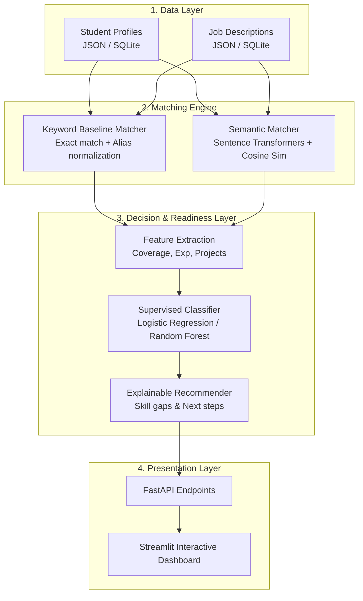

# University Placement Skill-Match Ranking and Interview Readiness System
**Problem ID:** LPU-PLACEMENT-01  
**Author:** Samridhjit Barnwal (BTech AI & ML)  
**Course:** CSE276 — Artificial Intelligence & Foundations  

---

## 📌 Project Overview
Traditional campus placement systems rely on strict keyword matching (e.g., if a student writes "NLP" and a job asks for "Natural Language Processing", the system counts it as a miss).

This project develops an **AI-assisted placement system** that:
1. Normalizes skills and accounts for common aliases (e.g., ML = Machine Learning).
2. Computes **semantic similarity** between student profiles and job postings using Sentence Transformers (`all-MiniLM-L6-v2`) and cosine similarity.
3. Provides a transparent **keyword matching baseline** to scientifically compare AI matching against traditional methods.
4. Uses a **supervised machine learning classifier** (Scikit-Learn Logistic Regression & Random Forest) to assess interview readiness based on objective coverage metrics.
5. Produces **explainable recommendations** with clear skill gap reports and human-in-the-loop review indicators.
6. Delivers a clean **Streamlit web dashboard** and **FastAPI** backend.

---

## 🏛️ High-Level System Architecture



---

## 📁 Project Directory Structure

```
placement_system/
├── README.md                 # Project documentation and milestone tracker
├── GLOSSARY.md               # Key definitions for viva & academic evaluation
├── requirements.txt          # Python dependencies
├── data/                     # Data storage
│   ├── students.json         # Student profiles (skills, exp, projects)
│   ├── jobs.json             # Job listings (required/preferred skills, exp)
│   └── training_dataset.csv  # Labelled data for readiness classifier
├── src/                      # Core business logic
│   ├── __init__.py
│   ├── verify_setup.py       # Environment verification script
│   ├── data_loader.py        # Input validation & JSON/SQLite loaders
│   ├── keyword_matcher.py    # Baseline exact matching module
│   ├── semantic_matcher.py   # Embedding & cosine similarity module
│   ├── readiness_model.py    # Scikit-learn feature extraction & model
│   └── recommender.py        # Gap analysis and human-readable feedback
├── app/                      # Application entry points
│   ├── main.py               # FastAPI backend
│   └── streamlit_app.py      # Streamlit multi-page web UI
└── tests/                    # Automated testing
    ├── __init__.py
    └── test_matchers.py      # Unit tests for matching and scoring
```

---

## 🚦 Milestone Roadmap

| Milestone | Title | Status |
| :--- | :--- | :--- |
| **Milestone 1** | Environment inspection, directory setup, virtualenv, verification | ✅ *Completed* |
| **Milestone 2** | Profile management using Python dictionaries & JSON | ✅ *Completed* |
| **Milestone 3** | Keyword matching baseline implementation & testing | ✅ *Completed* |
| **Milestone 4** | Semantic matching using Sentence Transformers & cosine similarity | ✅ *Completed* |
| **Milestone 5** | Job-level aggregation, ranking, and candidate skill mapping | ✅ *Completed* |
| **Milestone 6** | Labelled dataset creation with documented rubric & edge cases | ✅ *Completed* |
| **Milestone 7** | Supervised interview readiness classifier (Scikit-Learn) | ✅ *Completed* |
| **Milestone 8** | Explainability, confidence thresholds, and skill-gap recommendations | ✅ *Completed* |
| **Milestone 9** | Streamlit multi-page web interface | ✅ *Completed* |
| **Milestone 10**| SQLite persistence, input validation, and automated unit tests | ✅ *Completed* |
| **Milestone 11**| Scientific comparison: Baseline vs. AI matching metrics | ✅ *Completed* |
| **Milestone 12**| Final report, defense documentation, and demonstration guide | ✅ *Completed* |

---

## 🚀 How to Run the Application

### 1. Launch the Streamlit Web Application (Frontend Dashboard)
```bash
cd "Desktop/CSE276(AI & Foudation)/placement_system"
streamlit run app/streamlit_app.py
```
This opens your browser at `http://localhost:8501` featuring all 8 pages:
1. **Student Dashboard**
2. **Student Profile Editor**
3. **Available Jobs**
4. **Ranked Job Recommendations**
5. **Job-Match Explanation (Traceability Matrix)**
6. **Readiness & Skill-Gap Report**
7. **Administrator Job Manager**
8. **Dataset & Evaluation Dashboard**

### 2. (Optional) Run the FastAPI REST Backend
```bash
uvicorn app.main:app --reload --port 8000
```
Interactive Swagger API documentation available at: `http://127.0.0.1:8000/docs`.

### 3. Run Automated Unit Tests
```bash
python3 -m unittest tests/test_matchers.py
```

